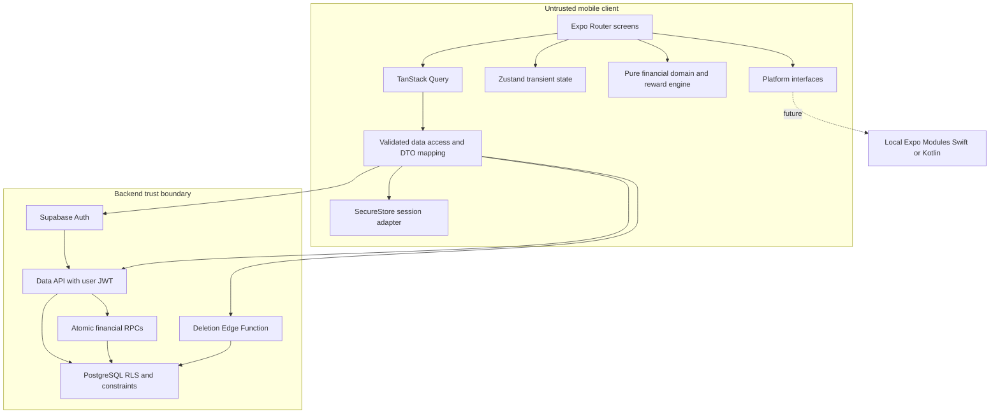

# Savora architecture

Status: architecture approved with revisions on 2026-11-19; Phase 1 authorized. Database and financial features remain design-only until their implementation phases. Savora is the working product name, without any claim of trademark clearance. Product promise: **Save with purpose. Spend with confidence.** Read with [schema](DATABASE_SCHEMA.md), [engine](REWARD_ENGINE.md), [plan](IMPLEMENTATION_PLAN.md), and [decisions](DECISIONS.md).

## Repository and environment inspection

Initial inspection on 2026-11-16 found an empty repository. On 2026-11-19, Git history contains the architecture proposal and project instructions in `AGENTS.MD` (case-sensitive filename). Those instructions were read before changes. The existing Linux filesystem location `/home/mitch/projects/earnest` is retained despite the product rename; no history is rewritten.

Observed toolchain: WSL2 Ubuntu/aarch64, Node 24.22.3, npm 11.19.1, Git 2.43.0. Docker and Supabase are not required for Phase 1. ARM64 backend tooling will be checked when database development needs it. No production resources are provisioned. See [development setup](DEVELOPMENT.md) and [dependency evidence](DEPENDENCIES.md) for implemented versions and validation status.

## System and decisions

Use one Expo TypeScript application and one Supabase PostgreSQL backend. No separate application server, monorepo framework, microservices, bank integration, payment processing, or recommendation AI. Financial calculations are pure TypeScript. Database constraints and transactional functions protect stored invariants even if a client is modified.

| Area                  | Proposal and responsibility                                                                                  |
| --------------------- | ------------------------------------------------------------------------------------------------------------ |
| Presentation          | React Native, Expo Router; routes compose feature screens and accessible primitives                          |
| Styling               | React Native StyleSheet with semantic design tokens in Phase 1; NativeWind deferred by explicit approval     |
| Server state          | TanStack Query caches owner-scoped reads and invalidates after acknowledged writes                           |
| Local state           | Zustand for small transient preferences/drafts only; not a second account ledger                             |
| Domain                | Money parsing, ledger summaries, budgets, goal allocation rules, affordability; no React or Supabase imports |
| Data access           | Supabase client, boundary validation, generated database types, feature query/mutation functions             |
| Backend               | Auth, RLS-protected reads/ordinary metadata writes, atomic PostgreSQL RPCs for financial mutations           |
| Privileged operations | Minimal Edge Function for authenticated account deletion; future imports/notifications only when needed      |
| Tests                 | Jest, jest-expo, React Native Testing Library, PostgreSQL/pgTAP policy tests and API integration tests       |

### Compatibility gate, not an unverified version pin

Selected SDK 58, with its bundled React/React Native/Router/native peer set, verified from npm metadata and Expo's version manifest before initialization. Node 24.22.3/npm 11.19.1 are pinned for reproducibility. Stable NativeWind 4.2.7 documents SDK 57 support, not SDK 58. On 2026-11-19 the owner explicitly approved StyleSheet for Phase 1 and deferring NativeWind; no SDK downgrade or prerelease is introduced. Reanimated is not installed without a current use; its compatible bundled version is recorded for later adoption. Exact installed versions and evidence belong in [DEPENDENCIES.md](DEPENDENCIES.md). Matching Expo Go and signed native verification are distinct pending device milestones, not local foundation blockers. [Expo SDK reference](https://docs.expo.dev/versions/latest/), [NativeWind guide](https://www.nativewind.dev/docs/getting-started/installation).

## Architecture and trust boundaries



```mermaid
sequenceDiagram
  participant U as User
  participant A as App
  participant S as Supabase RPC
  participant P as PostgreSQL
  U->>A: Allocate savings or record purchase
  A->>A: Validate input; assign retry UUID
  A->>S: JWT and mutation request
  S->>P: Verify owner; lock profile; validate snapshot
  P->>P: Atomic ledger/allocation changes; increment revision
  P-->>A: Committed result and revision
  A->>A: Invalidate queries; obtain consistent snapshot
  A->>A: Recompute deterministic affordability
  A-->>U: Updated actual balances and explained status
```

Reads use RLS and explicit columns. A read-only, security-invoker snapshot RPC returns balances, budgets, recurring obligation occurrences, allocations, wishlist, preferences, and profile revision from one SQL statement/MVCC snapshot. This avoids mixing independently cached financial states. The engine never treats caches or client-calculated unlocks as money. Writes use idempotency UUIDs, return committed state, and invalidate affected lists and snapshot. No optimistic financial balances; metadata may update optimistically with rollback. Serializing invariant-sensitive writes on the user's profile row is deliberately simple for a single-user workload. Expected revision rejects stale cross-device edits. Network failures show last successful timestamp; disable actionable unlocks while stale/offline. MVP is online-first, without offline write replay, persistent financial caches, or realtime subscriptions.

## Structure and module boundaries

```text
app/                         # route layouts, auth routes, five tab routes, modal entry points
src/
  features/{auth,accounts,transactions,budgets,goals,rewards,profile}/
    screens/ components/ queries/ mutations/
  components/ui/             # shared accessible visual primitives
  domain/{money,ledger,budgets,goals,rewards}/
  data/{supabase,mappers,validation}/
  platform/                  # secure session adapter, later native capability interfaces
  state/                     # minimal transient Zustand stores
  theme/                     # colors, typography, spacing tokens
  hooks/ types/ constants/    # only create modules when consumed
  test/                      # shared test fixtures and mocks
modules/                     # future local Expo modules, only when required
plugins/                     # future config plugins, only when required
supabase/{migrations,tests,functions}/
assets/
docs/
.github/workflows/
app.config.ts                # declarative platform configuration
eas.json                     # build profiles when implemented
```

Feature screens call feature hooks; hooks use data functions and domain functions. Domain modules accept validated structures and dates supplied by callers. Avoid generic repository factories, a DI framework, and a shared package until a second consumer exists. Generated DB types do not replace runtime validation. Small schema validation dependency (proposed Zod) is justified at user/API boundaries; engine independently checks monetary and snapshot invariants.

## MVP behavior and financial scope

US consumers, USD-only checking/savings, posted manual income/expenses and same-currency transfers, monthly budgets, manually entered recurring obligations, Goals, and Rewards. Account balance corrections use ledger adjustments, not overwrite. Opening balances are explicit signed entries (omit zero entries). Category answers “what was purchased”; **expense operation** classification answers ordinary/reward. One category can serve both. Optional wishlist association permits spontaneous rewards. Actual expenses post once, regardless of origin; reversal/replacement handles corrections/reclassification. Full rules are in the schema/engine.

**Goals: save toward something important.** Explicit virtual reservations protect existing pooled liquid money. Funding/reallocation/release does not transfer or create cash. **Rewards: enjoy what you can afford today.** Each item independently compares price with the same derived headroom; an unlocked list is a set of alternatives, never a funded bundle. Reordering affects display only. Record one purchase, reduce actual cash and recompute all eligibility immediately. No wallet or points. Large objectives usually fit Goals, but no price threshold enforces this.

Monthly ordinary budgets and recurring obligations protect upcoming commitments before rewards. Monthly obligation templates generate reviewable occurrences, linked payments settle them, and explicit coverage mode avoids budget overlap. For each category protect the greater of remaining budget and unpaid budget-covered bills; separately protected bills add only once and their payments do not release ordinary budgets. Obligations cannot also represent goal/reserve earmarks. Missing inputs or stale confirmations suppress confident affordability while keeping the app/history usable. These are conservative month-level estimates, not a paycheck/bill-time cash-flow guarantee.

Account modeling reserves future `credit_card`, `student_loan`, `auto_loan`, `mortgage`, `other` types and asset/liability classes. Only checking/savings assets can be created in MVP; L includes signed liquid balances (including overdrafts), never credit limits or loans. Future liability balances represent positive amount owed; borrowing raises debt and cash, principal payment reduces both, interest/fees are expenses. Principal is not a second expense or income. No liability/debt/interest/net-worth functionality is implemented now. See schema conventions for future repayment semantics.

Basic milestones/celebrations are derived. Banks, FX, debt tracking, subscriptions, remote notifications and persistent unlock entitlements remain deferred.

## Authentication, privacy and security

Approved verified email/password, reset-password and verification links, with allowlisted development and production redirects. Use generic auth error messages and provider rate limits; configure production email delivery before beta. Defer social login; reconsider Apple's login-service requirements if introduced. Route guards improve UX; RLS is the authorization boundary.

Persist sessions through an `expo-secure-store` adapter, not plain AsyncStorage. Follow Supabase's React Native session refresh/AppState lifecycle and serialize refresh using the SDK-supported lock mechanism. Handle token refresh failures, logout, reinstall and account switching explicitly. SecureStore can reject large values; implement a size-aware, tested adapter with versioned chunks and cleanup/commit handling if sessions exceed supported payloads; fail closed rather than falling back to plaintext. Do not require biometrics for background refresh; optional app lock is later. iOS Keychain items can survive reinstall, so revalidate with Auth on launch. Clear secure keys, queries, drafts and displayed data on logout/deletion. [SecureStore limitations](https://docs.expo.dev/versions/latest/sdk/securestore/), [Supabase React Native auth](https://supabase.com/docs/guides/auth/quickstarts/react-native).

Only Supabase URL and publishable key (legacy anon key if needed) belong in `EXPO_PUBLIC_*`. They are public identifiers, with access restricted by user JWT, grants and RLS. Never bundle service-role/secret keys, DB passwords, Apple credentials or provider secrets; build-time secrets referenced by bundled code become public too. Edge Functions use server secrets and verify JWT plus current user; privileged deletion additionally requires recent authentication and explicit confirmation. Logs omit tokens, transaction descriptions, amounts, email and request payloads; record sanitized error codes and request IDs. TLS in transit and provider encryption at rest do not constitute end-to-end encryption.

Enable RLS on every user table, no anonymous access, deny direct ledger writes, and enforce same-owner foreign keys. Profile revision and identity fields are server controlled. Use column grants/RPCs to prevent mass assignment. Definer RPCs are narrowly scoped, explicitly authorized, use fixed empty search paths and schema-qualified references, revoke default PUBLIC/anon execute, and must not trust passed user IDs. Views must be security-invoker or inaccessible to API roles. Supabase service credentials bypass RLS: isolate their use to the deletion function; never use them for routine client requests. Full policy/test design is in the schema. [RLS](https://supabase.com/docs/guides/database/postgres/row-level-security), [function security](https://supabase.com/docs/guides/database/functions).

Provide financial-data reset separately from account deletion, with reauthentication and transactional clearing. Account deletion deletes `auth.users` through server admin API; cascade all owned data and revoke sessions, then clear local state. Make retries safe if the user no longer exists; surface failure rather than claiming deletion succeeded. Previously issued JWTs may live until expiry: missing owner/profile and cascade must prevent access even then. Deletion also covers any later storage objects/provider records; MVP has neither. Offer authenticated JSON/CSV export before reset/deletion, guard CSV formula injection, and avoid uploading exports anywhere. State retention and backup expiration in the privacy policy; hard deletion from live tables does not instantly erase provider backups. Prefer a US Supabase production region; resolve actual backup/log retention, recovery objectives and subprocessors before production without inventing legal retention periods; document and drill restore in an isolated environment. No advertising or third-party analytics SDK in MVP.

## Navigation and design

Five tabs: Dashboard (actual liquid total, reserved goals, remaining budget, available rewards, trend), Transactions (filterable history and add flow; accounts/budgets as secondary screens), Goals (funding and progress), Rewards (reorder queue, reasons and assumptions), Profile (planning inputs, security, currency/timezone, export/reset/delete). Auth/onboarding sits outside tabs; creation/editing uses stack screens or sheets. Clearly label actual versus projected and “allocated” versus “held.” Show one headline status and reason, with an expandable calculation breakdown and last-confirmed date. Never imply unlocking means spending is required; celebrating saving is equally prominent.

Use restrained typography, neutral surfaces and one accent; subtle optional celebrations, no loss streaks or purchase pressure. Status combines words/icons with color. Support VoiceOver/TalkBack, dynamic text without clipping, reduced motion, sufficient contrast, accessible touch targets (at least 44pt iOS/48dp Android), announced validation errors, keyboard-safe forms and localized currency input. Small phones scroll; wider layouts constrain line length and support tablet widths without assuming fixed dimensions. Reordering needs accessible move-up/down actions. Simple accessible charts also offer textual totals; choose a compatible chart library only after the compatibility spike.

## WSL2, quality and delivery

Use VS Code Remote WSL, Linux Node and npm, a committed npm lockfile, LF source files, case-correct paths and scripts without absolute OS paths. Keep repo here rather than `/mnt/c`. Pin Node/npm/tool versions; use `npm ci` in CI. Use short feature branches, PR review including self-review, protected main and tagged releases. Codex implements approved phase-sized changes, reports tests, and updates these docs/decision log when behavior changes. Never commit `.env`, dumps, tokens or signing files; commit a placeholder `.env.example` only during implementation.

Local Supabase requires working ARM64 Docker images and WSL daemon integration. Test migrations from an empty database, synthetic seeds only. If ARM64 local stack fails, use disposable isolated hosted development/test projects for integration tests; never run destructive tests against production. Physical iPhone cannot reach WSL `localhost`; use a separate hosted development Supabase project initially. For Metro, start with Expo's tunnel using non-sensitive data; later configure supported WSL mirrored networking or explicit forwarding/firewall rules restricted to trusted LAN. Tunnel URLs are public; stop servers after use. VPNs, guest Wi-Fi isolation and Windows firewall can block LAN discovery. Keep phone/host on same trusted network and test a real connection. [Expo WSL guidance](https://github.com/expo/fyi/blob/main/wsl.md).

Jest/domain and component tests run in WSL without Xcode. CI on Linux runs lint, typecheck, unit/component tests, migration replay, pgTAP/API isolation tests and dependency checks. Use synthetic users with real authenticated roles, not service-role-only tests. Device smoke tests cover secure session persistence, links, keyboard, accessibility and purchase recording; automated native iOS UI/simulator tests require a macOS/cloud runner and are not part of WSL local testing. Prepare EAS profiles in Phase 1. Signed iOS build/device verification is a tracked external milestone, not a prerequisite to completing local foundation work; execute it before relying on custom native features and before release. Separate Supabase dev/prod projects; ephemeral CI database; development/preview/production EAS environments, distinct app identifiers where needed. No production data on development devices.

## iOS, EAS and future macOS

Initially use a matching Expo Go for basic flows; its fixed native runtime cannot load arbitrary native code. Verify physical iPhone client availability for the chosen SDK; current Expo documentation offers `eas go`/TestFlight for compatible versions, which can require paid Apple membership. Transition to `expo-dev-client` EAS cloud builds for native/config-dependent work and authentic app links. Cloud iOS compilation/submission works from WSL; local iOS simulator, compilation, Swift debugging and Instruments require macOS/Xcode. No claim that WSL replaces those tools. [Development builds](https://docs.expo.dev/develop/development-builds/introduction/), [Go version matching](https://docs.expo.dev/troubleshooting/expo-go-version-mismatch/).

Adopt Continuous Native Generation: `app.config.ts`, local modules, assets and config plugins are source of truth; generated `ios/` and `android/` stay uncommitted initially. On macOS, clone, use the same lockfile and supported Node, install Xcode/toolchain and generate with Expo Prebuild; shared TypeScript requires no platform rewrite. Custom Swift lives under a local Expo module, not handwritten changes to generated Xcode files. SwiftUI views can be hosted in module native views and exposed through typed React wrappers. Platform adapters (`*.ios.ts`, `*.android.ts`, neutral fallback) keep iOS features optional and Android buildable. Add Kotlin implementation only when Android needs that capability. Test clean regeneration; native dependency records must list version, license, supported SDK/New Architecture, platform support, config plugin, permissions, development-build requirement and verification date. EAS must receive module sources. Native changes require a new binary. [Custom native code](https://docs.expo.dev/workflow/customizing/), [Expo Modules](https://docs.expo.dev/modules/overview/).

Planned EAS profiles: development (`developmentClient`, internal physical-device distribution); preview (release-like internal build against dev backend); production (store distribution, production environment). Do not use simulator binaries on phones. Apple Developer Program membership, an Expo account, unique stable bundle ID and App Store Connect app are required for distribution; ad hoc builds require registered devices/provisioning. EAS can manage signing certificates/profiles; owner keeps account control and uses least-privileged App Store Connect API credentials in CI. Protect signing/submission secrets and require release approval. Select supported EAS image/Xcode for Apple's then-current submission minimum. [Build](https://docs.expo.dev/build/introduction/), [iOS submit](https://docs.expo.dev/submit/ios/).

Build a production binary, upload with EAS Submit, validate on TestFlight (external testing may require beta review), complete screenshots/support URL/privacy policy/age rating/export compliance/review access, then submit for App Review and release deliberately. Upload does not publish automatically. Use semantic user version and monotonically increasing iOS buildNumber; tie build to Git SHA, backend migrations and environment. Defer OTA updates; if adopted, runtime version must match native capabilities, channels/environments must be isolated, and native changes always rebuild. Maintain backward-compatible backend migrations for older installed clients with expand/contract releases and rollback/forward-fix plan.

In-app deletion and an accessible privacy policy are release requirements. Declare actual collected financial information, identifiers, contact details and diagnostics in App Store privacy answers, including Supabase and any future SDK. Review privacy manifests/required-reason APIs and dependencies, tracking choices, entitlements and encryption declarations for the final binary. Subscription billing and financial-services classification need a separate review if scope expands; this MVP neither holds nor moves funds. [Apple review rules](https://developer.apple.com/app-store/review/guidelines/), [privacy details](https://developer.apple.com/app-store/app-privacy-details/), [deletion](https://developer.apple.com/support/offering-account-deletion-in-your-app/).

## Extensibility and approval gates

Imports later add provider connections and staging/deduplication before posting through ledger commands; no direct imported balance overwrite. Subscription entitlements belong on the server, not in Zustand. Analytics can consume ledger history; scheduled notifications require durable events and consent. Multiple currencies require per-currency ledgers and explicit FX transfer legs/rates; never sum mixed currencies. Android reuses domain/screens with capability adapters. A web dashboard may reuse domain/data code, but needs its own secure browser session strategy; do not store browser sessions through a native adapter.

Architecture and Phase 1 are approved on 2026-11-19 with the policies above. Explicit seven-day financial confirmations, five-minute cached-snapshot limit and 24-month reward forecast are provisional configurable constants. Any eligibility-changing mutation invalidates snapshots immediately. Each account has a balance confirmation timestamp; profile planning confirmation is separate. Re-fetching does not attest manual data is accurate. Month rollover prompts budget/obligation/forecast review; stale data never locks users out of the app. Debt accounts are future-compatible only, recurring obligations belong in Phase 3, and auth in Phase 2. StyleSheet fallback is approved. Outstanding production decisions are final identifiers/ownership, US region selection, retention/recovery requirements, and final privacy materials. Paid Apple enrollment is needed for distribution, not Phase 1 local completion.
