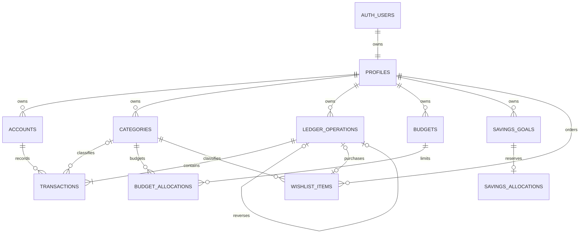

# Proposed PostgreSQL schema

Status: proposal only; no SQL has been deployed. Companion documents: [architecture](ARCHITECTURE.md), [reward engine](REWARD_ENGINE.md). The database is the authority for actual financial records; projections are never ledger entries.

## Conventions

All tables are owned by one authenticated user. Unless overridden, each has `id uuid PRIMARY KEY DEFAULT gen_random_uuid()`, `user_id uuid NOT NULL REFERENCES profiles(id) ON DELETE CASCADE`, `created_at timestamptz NOT NULL DEFAULT now()`, and `UNIQUE(user_id,id)` for composite ownership references. Mutable tables add server-maintained `updated_at timestamptz NOT NULL DEFAULT now()`. Column lists below add to these common fields. Every column is NOT NULL unless marked `?`; enum-like text uses CHECK constraints rather than migration-heavy PostgreSQL enums. Text has nonblank/length limits (names 120, descriptions/notes 2000, external IDs 255); never accept unconstrained payloads. JSON is not a substitute for typed financial fields.

Money is `bigint` cents, with individual absolute values capped at 10^12 cents. Database sums use exact `numeric` and RPCs reject supported aggregate overflow. API money and aggregate values are serialized as decimal **strings**, explicitly cast in RPC outputs; map to TypeScript `bigint` for domain arithmetic. Do not let PostgREST/JSON parse a large integer into a JS number first. UI progress ratios may use bounded derived numbers only after exact calculation. Currency is `text CHECK(currency='USD')` in MVP, with profile currency immutable after ledger data exists. Widening the currency constraint is a future migration, not FX support.

All nonnegative monetary settings/forecast fields also use the 10^12-cent input cap. All same-owner parent FKs between financial tables use `ON DELETE NO ACTION DEFERRABLE INITIALLY DEFERRED`; direct ownership FKs to profiles use `ON DELETE CASCADE`. This permits whole-owner cascade to remove related rows before commit while blocking deletion of a still-referenced account/category in normal operation. No client grant allows hard-deleting ledger parents.

Dates: ledger `posted_on date` is the user's financial date, never inferred from UTC creation time. Budget periods use the first local date of a month. Audit timestamps are UTC. User timezone is a validated IANA identifier; timezone changes affect future date defaults, not posted dates. Forecast dates are local ISO dates. Ranges, ownership, dates and strings are validated both at boundaries and in DB; multirow invariants require functions/triggers, not CHECK constraints containing queries.

## Tables

### profiles — owner, preferences and planning settings

Combines user preferences with profile to avoid a one-to-one preferences table. `id uuid PK REFERENCES auth.users(id) ON DELETE CASCADE`; no separate user_id or composite unique needed here. Common timestamps apply.

| Column | Type/default | Meaning/constraint |
|---|---|---|
| display_name | text? | Optional; no duplicate auth email |
| currency | text default 'USD' | Fixed MVP base currency |
| timezone | text | Validated IANA timezone |
| emergency_reserve_cents | bigint default 0 | Nonnegative, protected separately from goals |
| safety_buffer_cents | bigint default 0 | Additional nonnegative reserve |
| forecast_monthly_income_cents | bigint? | User-confirmed net income assumption, nonnegative |
| forecast_monthly_expenses_cents | bigint? | Full future month expenses including discretionary allowance |
| forecast_monthly_goal_cents | bigint? | Planned savings contributions, nonnegative |
| plan_confirmed_at | timestamptz? | Server time when user confirms plan completeness |
| onboarding_complete | boolean default false | Cannot complete without explicit reserve/forecast/budget review |
| financial_revision | bigint default 0 | Server-only monotonic concurrency marker |

Future forecast expenses must be at least the current total monthly budget limits, otherwise no projection. Reserve zero is a valid explicit choice; incomplete onboarding cannot silently opt into it. All financial writes/settings changes increase revision. Only RPC can update planning fields/revision; direct column grants may allow display_name only. Index: PK is sufficient. RLS: select own `id=auth.uid()`; no client insert/delete; safe update only own row with identity immutable. Profile bootstrap is a minimal auth trigger with fixed search_path, no reliance on user-editable auth metadata for permissions. User preferences deletion is account deletion or explicit data reset.

### accounts — manually managed liquid accounts

Fields: `name text`, `kind text CHECK IN ('checking','savings')`, `currency text`, `archived_at timestamptz?`.

No stored balance or opening balance column. Balance = sum of signed posted transaction amounts. Every active account is liquid and participates in the pool; account-specific earmarking is deferred. Archive only when balance is zero and no unfinished mutation exists, enforced under owner lock. No hard-delete UI for accounts with ledger history. Index `(user_id,archived_at,id)`; PK/composite key as above. RLS: own SELECT; metadata create/update through validated RPC so currency/archive/revision rules hold; no direct delete. Relationship: one account to many transaction legs.

### categories — user-owned expense and income labels

Fields: `name text`, `kind text CHECK IN ('income','expense')`, `spending_role text default 'ordinary' CHECK IN ('ordinary','reward')`, `is_default boolean default false`, `archived_at timestamptz?`. Income categories must be ordinary. Role becomes immutable once referenced.

Unique `(user_id,kind,lower(name))` using expression index; `(user_id,kind,archived_at)` for pickers. Seed user-owned defaults during onboarding (including an expense category for unplanned spending), no shared/global nullable-owner rows. Category kind is immutable once referenced. Expense transactions require expense categories and income transactions income categories; RPC/trigger validates kinds. Archived categories retain history and cannot receive new entries. RLS: own SELECT; validated metadata RPC writes; no hard delete while referenced. Transfer/opening/adjustment legs have no category.

### ledger_operations — command identity, grouping and correction link

This table is necessary for atomic two-leg transfers, retries and linked reversals. Fields: `kind text CHECK IN ('opening','income','expense','transfer','adjustment','reversal')`, `posted_on date`, `note text?`, `reverses_operation_id uuid?`, `request_fingerprint text`, `source text default 'manual' CHECK IN ('manual','import')`, `provider text?`, `external_id text?`. No updated_at: immutable. Its `id` is the client-generated retry UUID rather than a new server UUID on each retry.

Composite FK `(user_id,reverses_operation_id)` → own operation. Unique partial index `(user_id,reverses_operation_id) WHERE reverses_operation_id IS NOT NULL`: reverse an operation at most once. CHECK: only reversal kind has reverse link; cannot reference self. Trigger verifies target is an original (not a reversal), all legs are exactly negated, and target isn't already reversed. Future external identity unique `(user_id,provider,external_id)` where IDs are not null; provider and external ID must be both null or both present; manual requests have neither. Import path is not exposed in MVP. Request fingerprint is server-calculated from canonical request; reuse of same UUID with different content fails. Index `(user_id,posted_on DESC,id)`, plus reverse-link index above. RLS: own SELECT; client has no INSERT/UPDATE/DELETE grants. Narrow command RPCs insert atomically. No background job needed.

### transactions — immutable signed account movements

Fields: `operation_id uuid`, `account_id uuid`, `category_id uuid?`, `amount_cents bigint CHECK(amount_cents<>0 AND abs(amount_cents)<=10^12)`. No updated_at. Composite FKs `(user_id,operation_id)`, `(user_id,account_id)`, `(user_id,category_id)` reference respective owner keys. Parent references use deferred NO ACTION as specified above; a normal deletion of a referenced account/category/operation fails at commit. All owned tables cascade from profile, so whole-owner deletion removes every dependent before deferred constraints are checked. Migration tests must verify this behavior against the actual foreign keys.

The operation holds date/source/description; no duplicate copies on each leg. Ordinary income is one positive leg, expense one negative leg. Opening/adjustment is one signed uncategorized leg. Transfer is exactly two distinct accounts with identical currency and sum zero. Reversal copies all original account/category legs with opposite signs. Deferred constraint trigger validates complete operation shape at commit (including no zero-leg operations), not during the intermediate transfer insert. Unique `(operation_id,account_id)` avoids duplicate legs per account. Zero-start accounts have no opening leg because zero-valued transactions are prohibited. One nonzero opening operation per account is enforced by trigger/command under owner lock, not by a unique account transaction index. Index `(user_id,account_id,operation_id)` for balance/history, `(user_id,category_id,operation_id)` for spend aggregates, and `(user_id,operation_id)` for joins; filter dates via indexed operations. RLS: own SELECT only, no direct writes.

Balance corrections: reverse the original and optionally post a replacement in a single command with one retry identity; do not edit history. Separate unrelated reconciliation adjustments require an explicit note and are excluded from income/expense reporting. Reversals use the original posted date for corrected historical reporting, while creation timestamp shows when corrected. MVP excludes future-dated posted entries; upcoming obligations belong to budgets, not actual ledger balances. A future import staging process can handle pending/provider edits without rewriting posted records.

### budgets — one current/previous month envelope

Fields: `month_start date` with day=1, unique `(user_id,month_start)`. This small parent supports atomic monthly setup and completeness checks. Historical months persist; future templates are deferred. Index unique above suffices. RLS: own SELECT; create/metadata changes through RPC; no delete for configured periods. One-to-many budget_allocations.

### budget_allocations — monthly category limits

Fields: `budget_id uuid`, `category_id uuid`, `limit_cents bigint CHECK(0<=limit_cents AND limit_cents<=10^12)`. Composite FKs to own budget/category, unique `(user_id,budget_id,category_id)`. Only ordinary expense categories allowed by trigger; reward-category spending is tracked separately and never consumes the protected baseline budget. No funds move when a limit is created. Active ordinary expense categories must each have a current budget allocation before unlock evaluation; the unplanned category requires explicit allowance review, which may deliberately be zero. New categories invalidate planning confirmation until reviewed. Historical archived categories still contribute to month-to-date spending; their remaining budget may be retained or explicitly revised, never silently dropped. Index `(user_id,budget_id,category_id)` unique, plus `(user_id,category_id)` for FK operations. RLS own SELECT and validated RPC writes; no direct delete except controlled period setup/reset. Budget and lines committed together.

### savings_goals — target and contribution intent

Fields: `name text`, `description text?`, `target_cents bigint CHECK(0<target_cents AND target_cents<=10^12)`, `priority integer CHECK(priority>0)`, `target_date date?`, `planned_monthly_cents bigint default 0 CHECK(0<=planned_monthly_cents AND planned_monthly_cents<=10^12)`, `status text default 'active' CHECK IN ('active','completed','archived')`.

Current allocated amount is joined from savings_allocations, never a second stored counter. Percentage is derived; target changes below allocation require a release in the same RPC. Optional date can become past due without invalidating stored data. A funded goal is not automatically a completed purchase; explicit completion with release/spend required. Index `(user_id,status,priority,id)`. RLS own SELECT and metadata RPC writes; no hard delete with allocation. Goal forecast contributions total must fit profile's monthly commitment; incoherence blocks estimates. Emergency fund, when represented as a goal, is **not** also counted in emergency_reserve_cents: onboarding asks user to choose one representation; MVP recommends the protected setting and labels any similarly named goal as additional savings.

### savings_allocations — virtual reservation per goal

Fields: `goal_id uuid`, `amount_cents bigint CHECK(0<=amount_cents AND amount_cents<=10^12)`. Composite FK own goal; unique `(user_id,goal_id)` (one current reservation per goal). No account FK: reservations are against the pooled liquid assets, not actual transfers. Extra allocation history table is deferred. Index unique above suffices. RLS own SELECT only, no direct writes. Funding/release RPC validates active goal, amount<=target, and locks profile. New/increased total reservations must not exceed `max(0, liquid_balance - emergency_reserve - safety_buffer)` using current ledger. This does not certify budget sufficiency: remaining monthly budgets are protected additionally by the engine. Spending/adjustments can subsequently underfund allocations; never reject honest expense recording or auto-delete reservations. Return deficit warning and lock rewards until resolved. Completed/archived goals must have zero allocation; closing a goal atomically releases funds or consumes them with a categorized expense. No ledger entry for allocating/releasing.

### wishlist_items — ordered competing purchases

Fields: `name text`, `description text?`, `estimated_price_cents bigint CHECK(0<estimated_price_cents AND estimated_price_cents<=10^12)`, `priority text CHECK IN ('high','medium','low')`, `position integer CHECK(position>=0)`, `category_id uuid`, `target_purchase_date date?`, `status text default 'active' CHECK IN ('active','purchased','archived')`, `purchase_operation_id uuid?`.

Composite FK own reward expense category and own ledger operation. Reward categories classify optional purchases separately from ordinary monthly envelopes; they do not receive budget allocations. `position` is the authoritative queue order; priority is a visual label and never silently changes order. Unique `(user_id,position) DEFERRABLE INITIALLY DEFERRED` allows atomic reorder; archived/purchased rows retain unique positions, active items sort by position then id. RPC assigns/rebalances positions under owner lock. Partial unique `(user_id,purchase_operation_id)` for nonnull values. CHECK purchased iff purchase link present. Trigger validates linked operation is an owned reward expense in the item category; purchase reversal/replacement linkage updates occur within the correction transaction. Purchase command posts actual price and sets status atomically, even if different from estimated price or currently locked; this app records reality rather than authorizes payments. Reversing linked purchase resets item active and clears link in same correction command; preserve audit via ledger. Index `(user_id,status,position)` plus `(user_id,category_id)` for ownership FK. RLS own SELECT and metadata RPC writes, purchase fields command-only. Price/category/order changes increment revision and invalidate calculations.

## Deferred and derived entities

| Entity | MVP treatment |
|---|---|
| User preferences | Columns in profiles |
| Reward unlocks | Derived each snapshot; never persistent entitlements |
| Financial milestones | Derived goal/budget progress, optional local celebration deduplication |
| Wishlist progress | Derived queue headroom, no dedicated allocation balance |
| Recurring bills | Deferred; current month complete budgets and explicit future assumptions |
| Provider connections/import staging | Deferred; source/external identifiers reserve integration path |
| Notifications/badges/challenges/subscriptions | Deferred until actual product scope requires persistence |

## Entity relationships

All child rows also carry direct profile ownership even where omitted from diagram for legibility. Composite owner foreign keys prevent assigning another user's parent ID even if guessed.

## Transactional commands and consistency

Financial commands: post opening/income/expense/transfer/adjustment; reverse/replace; set monthly budget; allocate/release/close goal; reorder/edit wishlist; record purchase; confirm/change planning settings; reset data. Each authenticates `auth.uid()`, locks profile `FOR UPDATE` first, checks expected revision, validates owned references, commits all changes and increments revision once. Retries find the previously committed UUID/fingerprint **before** rejecting an old expected revision. Ledger operation UUIDs persist retry results. Metadata/funding commands are set-to-value with expected revision: after ambiguous timeout refetch revision/state and reconcile rather than blindly replaying a delta. Reordering sends entire active order or explicit target position and validates no duplicate/missing IDs. Reset is idempotent to empty state.

Scope is one user, so a profile lock is sufficient, understandable, and avoids allocation/purchase races. Snapshot RPC reads one statement with a single snapshot and returns revision plus string-encoded monetary aggregates. Account totals are sums of every posted leg; monthly income/expense classify both originals and reversals using original operation kind. Expense spend is `max(0,-sum(expense-family signed legs))` per category: reversals subtract original spend; transfers/opening/adjustments excluded. Reversal kind must join target operation to classify correctly. No unversioned materialized balance caches. Whole-owner deletion is the only exception to immutable ledger history.

## RLS and privileges

Enable RLS for every table in the creation migration. For rows with user_id, SELECT policy for authenticated is `(select auth.uid()) = user_id`; if any direct metadata INSERT/UPDATE is granted, use both matching USING and WITH CHECK, disallow owner changes, and restrict columns. Preferred proposal uses RPC writes for all revision-sensitive metadata, so there is no general table write grant. Profiles select by id; bootstrap only through trusted trigger. No anonymous table or function access. Grant SELECT only on intended tables/columns to authenticated. Grants and RLS must both permit an operation; neither alone is enough.

Definer commands bypass table write restrictions only after verifying the caller and deriving ownership from auth, with `search_path=''`, fully qualified names, no dynamic SQL and an explicit narrow execute grant. Use a dedicated least-privileged owner role where supported, not unrestricted ownership for convenience. Revoke default PUBLIC execute and configure default privileges so new functions aren't exposed accidentally. Trigger helpers/private implementation functions reside outside exposed schemas with no direct client execute. Read functions use invoker security. No definer views. Authorization never relies on mutable user metadata or client owner claims. See [Supabase RLS](https://supabase.com/docs/guides/database/postgres/row-level-security) and [functions](https://supabase.com/docs/guides/database/functions).

## Database and security verification

Use migrations plus synthetic seed fixtures, not dashboard-only edits. CI replays from empty DB and tests upgrade from the previous release. pgTAP verifies keys/checks/triggers/grants/RLS; Supabase API tests use two genuine users A/B and unauthenticated/expired sessions. Test SELECT/INSERT/UPDATE/DELETE, owner spoofing, parent-ID substitution, RPCs, views, aggregates, empty snapshots, exports and deletion. B must neither read nor mutate A's data nor infer amounts through snapshot RPC. Check direct table writes fail even for own ledger rows; execute helper functions fails; anonymous access fails. Assert policy expressions, enabled RLS and grants for every new table in migration tests.

Invariant tests: transfer commits both legs or none; sum across accounts unchanged; reversal exactly negates and cannot repeat; corrections update historical spend; retries don't duplicate; same UUID/different body rejected; invalid categories/currencies/future dates rejected; concurrent allocations and reorder conflict deterministically; actual spending can expose reserve deficit; no cross-owner cascade; reset/delete removes all owned rows and denies stale JWT access. Test monetary serialization above Number.MAX_SAFE_INTEGER in aggregates, bounded input rejection, SQL/domain summary parity, month/timezone boundaries and snapshot consistency during writes. Verify financial_revision cannot be client-assigned. Run deletion cascade test against the actual migration FK actions, not a mocked database. Never use production or service-role-only tests as evidence of user isolation.
